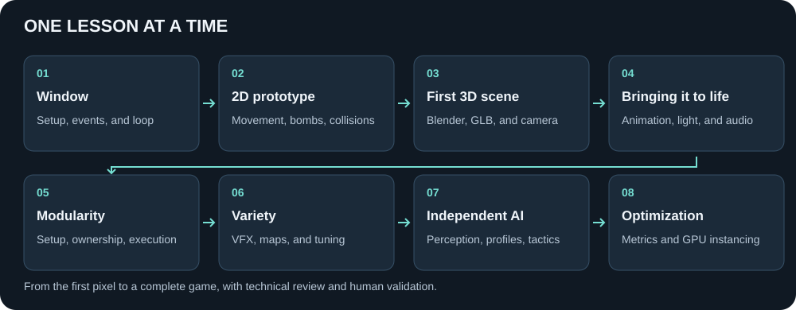
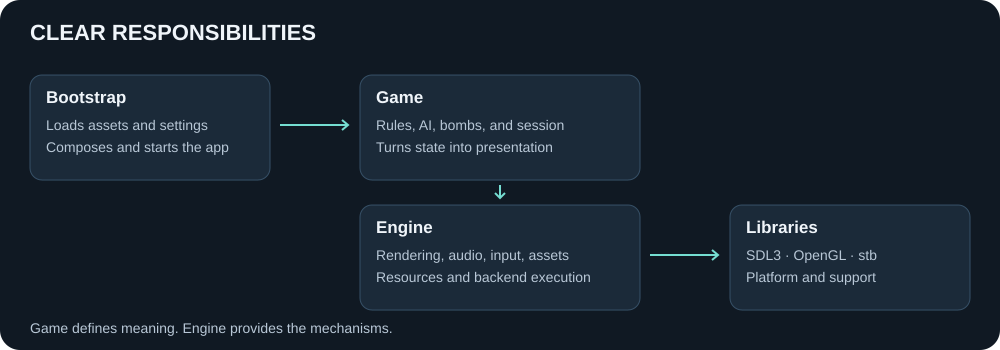

# Bomberman C++

**From the first window to a 3D game — a study of C++, graphics, and development with AI agents.**

A Bomberman game built in C++20, with a small custom engine using SDL3 and OpenGL.
It started as a way to understand how 3D games work and build a stronger foundation
for Unreal development. Along the way, it became a study of architecture,
integration, and coordinating specialized agents.

## Watch the game

[**Watch the development playlist on YouTube**](https://www.youtube.com/watch?v=HNhkYpmBmrY&list=PLGrHjHFs8JaI)

Follow the project from the 2D prototype to 3D gameplay and distinct enemy personalities.

## From a window to a game



1. **Open a window.** Set up CMake, build Debug and Release, integrate SDL,
   and implement events, updates, and shutdown.
2. **Draw and interact in 2D.** The first OpenGL triangle grew into a grid
   with movement, collisions, bombs, explosions, and destructible walls.
3. **Move into 3D.** Import GLB models created in Blender, place the arena
   and characters, and frame the scene with an elevated camera.
4. **Bring the scene to life.** Add animation, textures, lighting, shadows,
   bloom, UI, and sound effects.
5. **Organize what grew.** Separate setup, resource ownership, and execution;
   split Gameplay and Rendering into components with clear responsibilities.
6. **Add variety.** Introduce fire and smoke, configurable maps and seeds,
   a camera that follows the player, and external tuning values.
7. **Give each enemy its own brain.** Independent perception, memory,
   and decisions, with five profiles, item collection, and tactical use of multiple bombs.
8. **Measure and optimize.** Investigate numerical safety and frame costs,
   reuse data, and batch repeated meshes with GPU instancing.

### Development videos

| Stage | Video |
| --- | --- |
| 00 | [2D prototype](https://www.youtube.com/watch?v=HNhkYpmBmrY) |
| 02 | [Early 3D evolution](https://www.youtube.com/watch?v=m1yDTUzsrqY) |
| 03 | [3D walls](https://www.youtube.com/watch?v=8H6R3n63hpQ) |
| 04 | [3D bombs](https://www.youtube.com/watch?v=8kJnXZGzpww) |
| 05 | [First enemy AI](https://www.youtube.com/watch?v=c5G2861koGE) |
| 06 | [Lives and damage](https://www.youtube.com/watch?v=Wf9fYq8hXss) |
| 07 | [Sound effects](https://www.youtube.com/watch?v=CC7SGYJztqA) |
| 08 | [Start screen](https://www.youtube.com/watch?v=Mo_7cJvLSks) |
| 09 | [Arena development](https://www.youtube.com/watch?v=W-mjTjHmbpc) |
| 10 | [Enemy AI evolution](https://www.youtube.com/watch?v=k3y2apZYSDk) |
| 11 | [Particle effects](https://www.youtube.com/watch?v=inzGPR8Ge3M) |
| 12 | [Map generation](https://www.youtube.com/watch?v=gKsZHMyX_Eo) |
| 13 | [Further enemy AI evolution](https://www.youtube.com/watch?v=gsUtOhEl_Jw) |
| 14 | [Enemy personality profiles](https://www.youtube.com/watch?v=3POMw91yxrw) |
| 15 | [More personality profile gameplay](https://www.youtube.com/watch?v=vhJPiV4fhg8) |

## What's in the final game

- Title screen, pause, victory, defeat, and restart.
- An animated player, three enemies, pickups, and chain reactions.
- Five AI profiles: Aggressive, Coward, Strategist, Hunter, and Scavenger.
  Colors and auras help identify each profile.
- Square or rectangular arenas, with odd dimensions from 11 to 31 cells.
- A fixed seed or a new random seed on each reset.
- An adaptive follow camera, directional shadows, HDR, and bloom.
- A small VFX system with fireballs and textured smoke.
- Sound effects and assets with their authoring sources preserved.

Speeds, timers, dimensions, AI profiles, and camera settings can be adjusted in
[`config/gameplay_tuning.cfg`](config/gameplay_tuning.cfg).
Comments explain what each value changes; configuration is loaded at startup.

## Project structure



| Folder | Responsibility |
| --- | --- |
| [`src/bootstrap/`](src/bootstrap/) | Load data and compose the application. |
| [`game/`](game/) | Rules, session, collisions, bombs, pickups, AI, and game presentation. |
| [`engine/`](engine/) | Platform, input, audio, asset loading, animation, and rendering. |
| [`assets/`](assets/) | Runtime files: GLB, PNG, and WAV. |

The design separates **setup**, **resource ownership**, and **execution**.
The game defines the rules; the engine receives data and commands to present them.

## Developing with agents

I directed and validated the project with support from specialized agents
in Engine Core, Rendering, Assets, Gameplay, Audio, and Performance.

The workflow was to define the result, assign responsibility, implement, test,
review, and validate the experience in the game. The Tech Lead kept integration
coherent; I guided priorities, behavior changes, and visual and audio approvals.

This became one of the main lessons of the project:
**expressing intent clearly, defining contracts, and reviewing evidence
are part of software development.**

The project also produced a set of internal retrospectives about mistakes,
successes, and practices to carry into future projects.

## A performance review result

On the **31×31** arena, instancing reduced average draw calls from roughly
**6,737 to 65 per frame — 99% fewer draw calls**.

Instead of issuing a separate call for each repeated object, the renderer submits
groups of instances. The entire scene is still rendered. In the measured scenario,
average render time dropped from 16.65 ms to 14.26 ms. These are historical
measurements taken under WSLg, rather than an FPS guarantee.

## Build and play

Validated environment: **Ubuntu 22.04 / WSL2**, GCC 11, CMake, and OpenGL 3.3 Core.
Other platforms have not been validated.

Requirements: a C compiler and a C++20 compiler, CMake 3.16+, Git, X11 and OpenGL
development libraries, and PulseAudio development support for WSLg audio.
CMake fetches pinned revisions of SDL3 and stb; the first configure requires
internet access.

From the repository root:

```sh
cmake -S . -B build/release -DCMAKE_BUILD_TYPE=Release
cmake --build build/release --parallel 2
SDL_VIDEO_DRIVER=x11 ./build/release/bomberman
```

| Key | Action |
| --- | --- |
| WASD or arrow keys | Move |
| Space | Start, place a bomb, or restart after a match |
| P | Pause / resume |
| F1 | Show / hide debug visualization |
| Window close button | Exit |

## Technologies and lessons

**C++20 · SDL3 · OpenGL 3.3 · GLSL · CMake · Blender · GLB/glTF · Python · SoX**

The study covered application lifecycle, resource ownership, 3D math, skeletal
animation, rendering passes, map generation, Utility AI, VFX, audio, and
optimization guided by measurements.

My next step is to take these architecture and workflow lessons into Unreal projects.

## Usage

Original content in this repository is available under the [MIT license](LICENSE).
You may use, modify, and distribute it, including commercially, while retaining
the license notice. SDL3 and stb retain their own licenses.

An independent study project inspired by Bomberman, with no affiliation with Konami.
